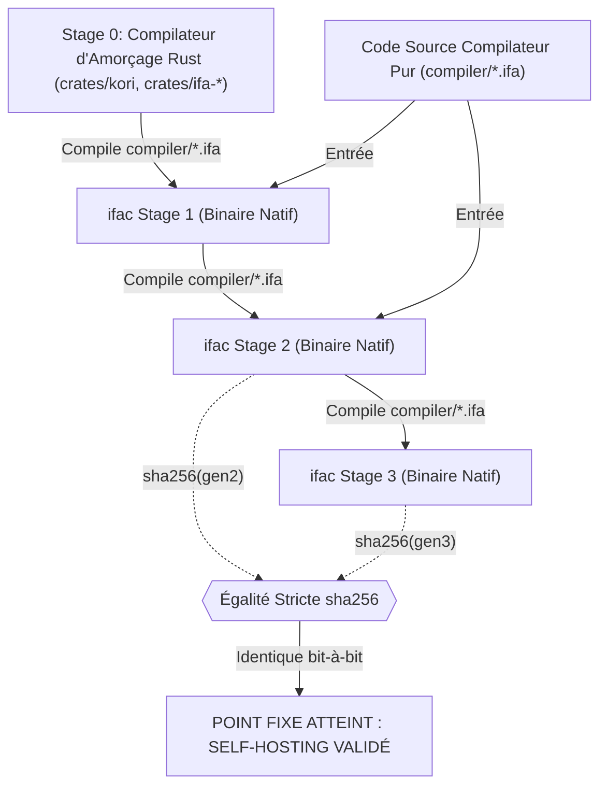

# Architecture de Référence de l'Auto-Compilation IFA (Self-Hosting Architecture Reference)

## 1. Vision et Objectif Fondamental

Le langage **IFA** a pour objectif suprême son **auto-compilation complète (Self-Hosting)**, matérialisée par la convergence déterministe bit-à-bit :

$$\text{sha256}(\text{ifac-gen2}) == \text{sha256}(\text{ifac-gen3})$$

Cette égalité stricte prouve mathématiquement que :
1. Le compilateur écrit en syntaxe pure IFA (`compiler/*.ifa`) est capable d'exprimer et de compiler l'intégralité de sa propre logique de compilation.
2. La chaîne d'outils est totalement affranchie de tout biais, artefact résiduel ou dépendance intrinsèque du compilateur d'amorçage hôte (Stage 0 Rust).
3. L'émission du code intermédiaire (LLVM IR) et la génération de code objet natif sont strictement déterministes bit-à-bit.

---

## 2. Le Pipeline de Bootstrap Multi-Stage

Le cycle d'auto-hébergement s'articule autour de quatre générations successives de compilateurs :



### 2.1. Stage 0 : Compilateur d'Amorçage Rust (`crates/`)
- Développé en Rust avec le binaire d'orchestration `kori`.
- Fournit la suite complète des passes initiales :
  * `ifa-lexer` : analyse lexicale, mots-clés, chaînes brutes, indentation et délimiteurs.
  * `ifa-parser` : parsing récursif descendant, production de l'AST canonique.
  * `ifa-sema` : vérification de types, résolution des symboles, modificateurs de passage (`in`, `inout`, `sink`), analyse d'accès disjoints (`AccessPath`), typage de canaux, fibres et arènes.
  * `ifa-fir` : représentation intermédiaire fonctionnelle en forme SSA pure avec optimisations d'inlining et élimination de code mort.
  * `ifa-codegen-llvm` / `ifa-codegen-cranelift` : émission de code machine natif.
  * `ifa-runtime` : runtime statique sans ramasse-miettes (GC), comprenant l'allocateur à arène générationnelle CoW et le scheduler de fibres incolores M:N.

### 2.2. Stage 1 : Compilateur Écrit en IFA Pur (`compiler/`)
- Rédigé exclusivement en langage IFA modulaire sans aucune dépendance Rust :
  * `compiler/lexer.ifa` : scanner lexical déterministe avec table de correspondance (LUT) de mots-clés évaluée à la compilation (`comptime`).
  * `compiler/parser.ifa` : analyseur syntaxique modulaire bâtissant l'AST sur arènes de mémoire avec annotations de mutabilité CoW.
  * `compiler/sema.ifa` : vérificateur sémantique vérifiant les types stricts, les contraintes de traits multiples (`where` clauses), la complétude des tables d'implémentation, et la sécurité générationnelle des références.
  * `compiler/codegen_llvm.ifa` : générateur de code LLVM IR textuel déterministe, avec tables de saut pour le filtrage par motif (`match`) et abaissement des dispatchs virtuels de traits en fat pointers.
  * `compiler/driver.ifa` : ordonnanceur de compilation multi-modules, tri topologique de graphe de dépendances (Kahn), passes IPO et DCE inter-modules, générateur de tables d'export symbolique native (ELF/Mach-O), et packaging autonome.
  * `compiler/main.ifa` : point d'entrée exécutable (`ifac`) gérant l'interface CLI (`-S`, `-c`, `-o`, `--emit-ir`, `--opt-level`).

### 2.3. Stage 2 : Premier Compilateur Produit Nativement par IFA
- `ifac-gen2` est compilé à partir des sources `compiler/*.ifa` en utilisant `ifac` Stage 1.
- À ce stade, le compilateur est entièrement assemblé par du code généré par IFA lui-même.

### 2.4. Stage 3 : Validation du Point Fixe
- `ifac-gen3` est compilé à partir des mêmes sources `compiler/*.ifa` en utilisant `ifac-gen2`.
- L'égalité binaire stricte :
  $$\text{sha256}(\text{ifac-gen2}) == \text{sha256}(\text{ifac-gen3})$$
  constitue la certification formelle de reproductibilité et d'invariance d'auto-hébergement.

---

## 3. Déterminisme Binaire Bit-à-Bit

L'obtention d'un hash identique impose une discipline rigoureuse d'élimination de tout non-déterminisme :

| Source Potentielle d'Indéterminisme | Stratégie d'Élimination dans IFA |
| :--- | :--- |
| **Itération de tables de hachage aléatoires** | Remplacement intégral par des structures ordonnées déterministes (listes triées lexicographiquement, algorithme de tri par insertion/sélection déterministe). |
| **Horodatages et dates de compilation** | Exclusion totale des macros `__DATE__`, `__TIME__`, timestamps UNIX ou métadonnées temporelles dans l'IR LLVM et les manifests. |
| **Pointeurs et adresses mémoire de l'hôte** | Remplacement des identifiants basés sur des pointeurs par des numérotations séquentielles stables de registres virtuels SSA (`%1`, `%2`, etc.) et de blocs (`%bb.0`, `%bb.1`). |
| **Chemins absolus de fichiers** | Normalisation stricte de tous les chemins d'accès sous forme relative au module ou à l'espace de travail. |
| **Ordre d'émission des fonctions et symboles** | Tri lexicographique strict des descripteurs de symboles natifs (`sort_native_symbols_lexicographically`). |

---

## 4. Modèle de Mémoire et Concurrence Sans Garbage Collector

Le modèle de mémoire d'IFA est conçu pour éliminer simultanément les pauses de ramasse-miettes (GC pauses) et la complexité des annotations de durées de vie manuelles :

### 4.1. Modificateurs de Paramètres et Chemins Disjoints
- `in` : Emprunt immuable partagé.
- `inout` : Emprunt mutable exclusif avec vérification formelle de non-chevauchement des chemins d'accès (`AccessPath`).
- `sink` : Transfert définitif de propriété (Move semantics), invalidant l'accès sur l'appelant.

### 4.2. Sémantique de Valeur et Copy-on-Write (CoW) In-Place
- Les structures de données d'AST volumineuses et les chaînes de caractères partagent leurs sous-arbres via un compteur de référence atomique.
- Lors d'une mutation, si le compteur vaut 1, la modification est effectuée **immédiatement in-place** sans aucune réallocation.
- Si le nœud est partagé, un clonage local de la tranche superficielle est exécuté de manière transparente.

### 4.3. Arènes Générationnelles et Références Sécurisées (`ref`)
- Allocation O(1) par incrémentation de pointeur (Bump allocation) dans des arènes de compilation typées (`scratch`, `ast_arena`).
- Réinitialisation instantanée de l'arène (`ifa_rt_arena_reset`) en fin de phase de compilation, libérant des millions de nœuds sans coût unitaire de désallocation.
- Les références générationnelles (`ref<T>`) vérifient le tag de génération pour interdire tout dangling pointer.

### 4.4. Concurrence Incolore (Fibres M:N)
- Planification coopérative de fibres légères sans pile d'appels lourde système.
- Synchronisation via canaux typés (`Channel<T>`) avec multiplexage déterministe priorisé (`select`).

---

## 5. Tables d'Exportation Symbolique Native (ELF & Mach-O)

Le compilateur autonome `ifac` intègre un générateur direct de tables de symboles pour les formats binaires cibles standards :

### 5.1. Format ELF64 (Linux / BSD)
- **Entrée 0 Nulle (`STN_UNDEF`)** : Respect strict du standard System V ABI.
- **Partitionnement Déterministe** :
  * Les symboles locaux (`STB_LOCAL = 0`) sont obligatoirement émis en premier, fixant l'attribut `sh_info = local_count` dans l'en-tête de section `.symtab`.
  * Les symboles globaux (`STB_GLOBAL = 1`) et faibles (`STB_WEAK = 2`) sont émis dans un ordre lexicographique déterministe.
- **Table de Chaînes (`.strtab`)** : Offsets calculés de façon monotone croissante avec terminaison nulle `\0`.

### 5.2. Format Mach-O (macOS / Darwin)
- **Table `LC_SYMTAB`** : Génération des entrées `nlist_64`.
- **Mangling Système** : Préfixage systématique des symboles natifs par un caractère de soulignement `_`.
- **Indicateurs de Liaison** : Combinaison de `N_SECT` (0x0e) et du bit d'exportation externe `N_EXT` (0x01).

### 5.3. Préservation Linker LLVM
- Émission automatique du tableau global `@llvm.used` contenant les pointeurs vers tous les symboles marqués comme exportés :
  ```llvm
  @llvm.used = appending global [N x ptr] [ptr @sym1, ptr @sym2], section "llvm.metadata"
  ```
- Application des attributs de visibilité LLVM (`default`, `hidden`, `protected`).

---

## 6. Packaging de Distribution Autonome & Runtime Statique

Le sous-système de packaging autonome du driver (`compiler/driver.ifa`) permet de produire des distributions entièrement statiques d'`ifac` :

### 6.1. Bibliothèque Standard Embarquée (`StdlibModuleManifest`)
La distribution embarque nativement l'ensemble des modules systèmes indispensables :
1. `std/fs` : E/S de système de fichiers, parcours d'arborescences, lecture et écriture déterministe.
2. `std/process` : Lancement de processus fils (assembleur, linker système).
3. `std/collections` : List, Map ordonnée, Set, ByteBuffer, StringBuilder.
4. `std/io` : Flux d'entrée/sortie standard et tampons de flux.
5. `std/sync` : Primitives de verrouillage et canaux de communication de fibres.
6. `std/crypto` : Hachage cryptographique Blake3 et SHA-256 déterministe.
7. `std/fmt` : Formatage typé sans allocation dynamique.
8. `std/iter` : Combinateurs d'itérateurs zéro-allocation.
9. `std/json` : Sérialisation et désérialisation canonique.

### 6.2. Runtime Statique Sans Dépendance Hôte (`StaticRuntimeBundle`)
- Modèle autonome d'exécution exempt de dépendance dynamique vers la libc de la machine hôte :
  * Allocateur mémoire CoW/arène autonome (`generational_cow_arena`).
  * Moteur de fibres incolores M:N (`m_n_colorless_fibers`).
  * Moteur d'E/S bloquantes et événementielles (`deterministic_blocking_and_reactor`).
  * Gestion de panique déterministe zéro-tas.
- Archivage autonome via stripping des symboles superflus (`strip --strip-all`) et scellement d'intégrité par condensat SHA-256.

---

## 7. Résumé du Banc d'Essai Automatisé

Le banc d'essai automatisé (`tests/bootstrap_fixed_point_test.rs`) orchestre la validation continue :
- **324 Tests Unitaires Modulaires** : Couvrant le lexer, le parser, la sémantique, la génération LLVM IR et le driver autonome.
- **Triple Compilation et Égalité des Condensats** : Validation séquentielle des générations `ifac-gen1`, `ifac-gen2` et `ifac-gen3` avec test de condensats SHA-256.
- **Compilation de Sources Externes** : Vérification qu'un binaire `ifac` autonome produit des exécutables natifs autonomes exécutables avec succès.
